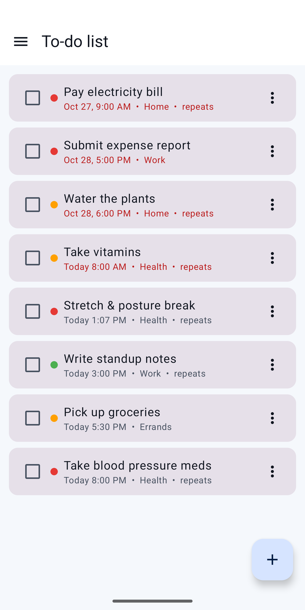
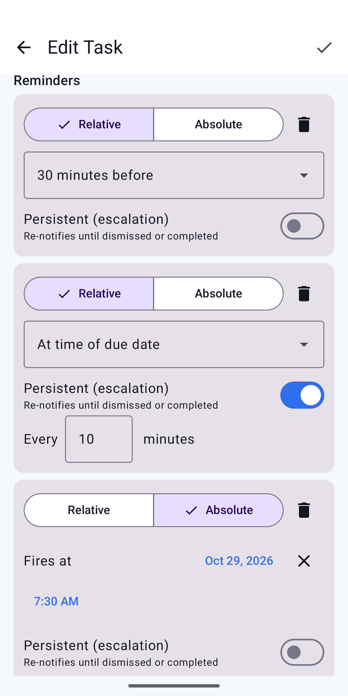
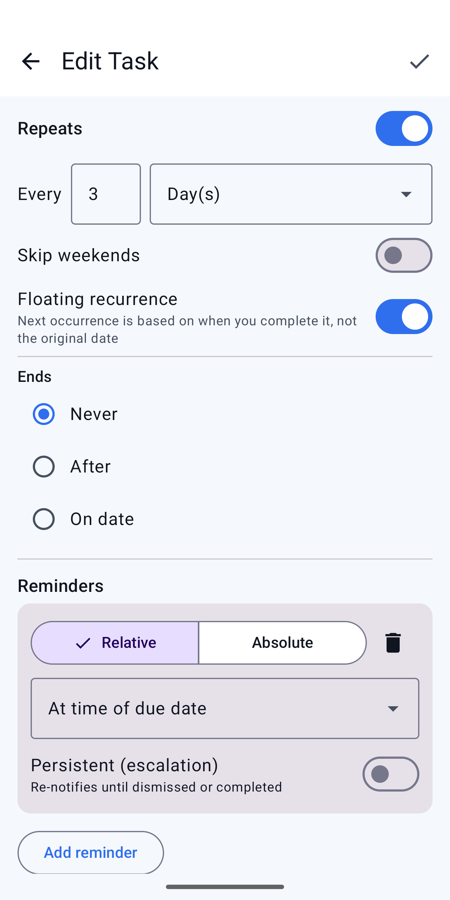
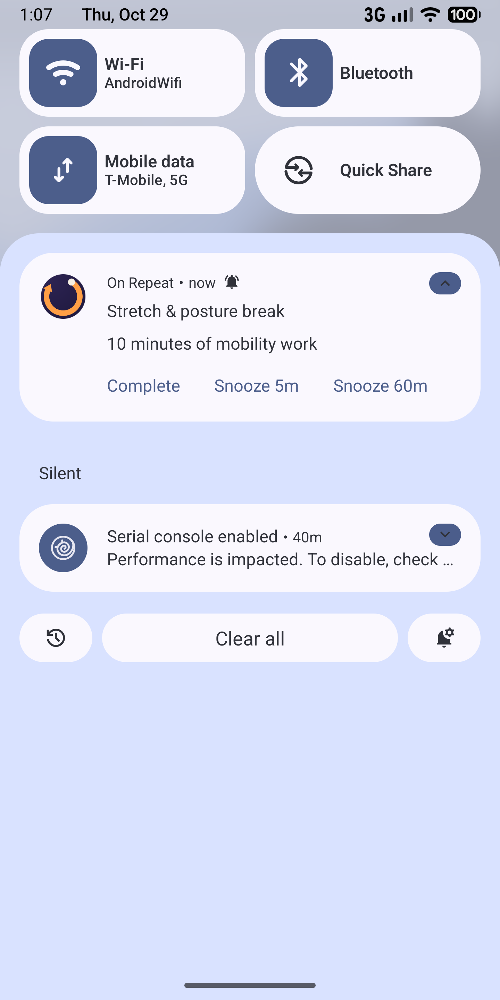
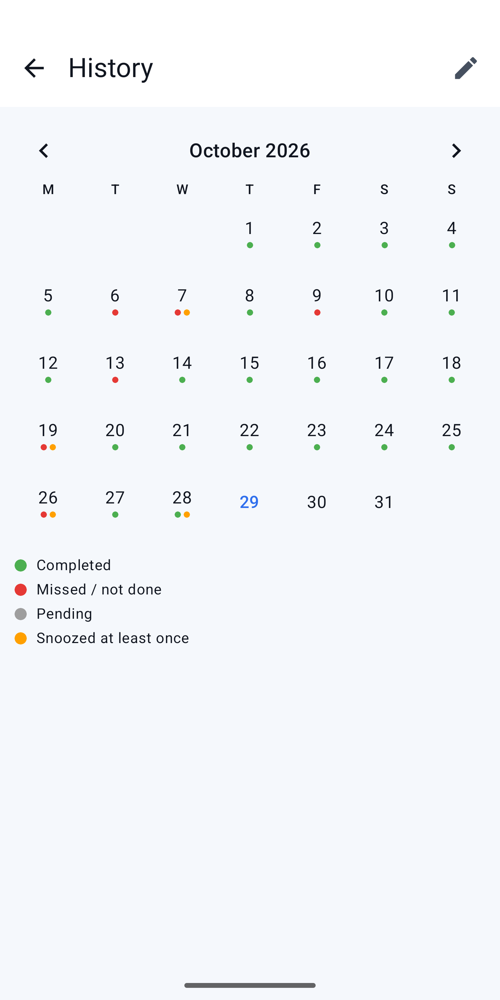
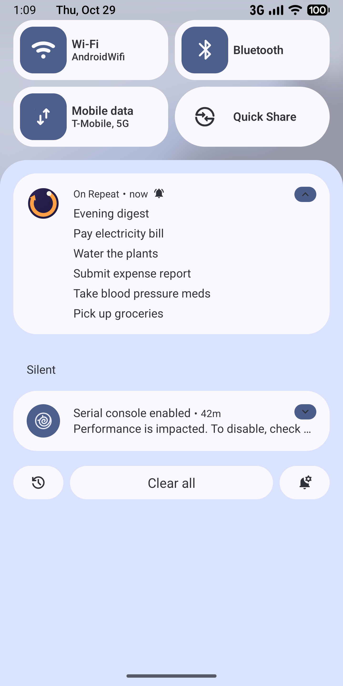
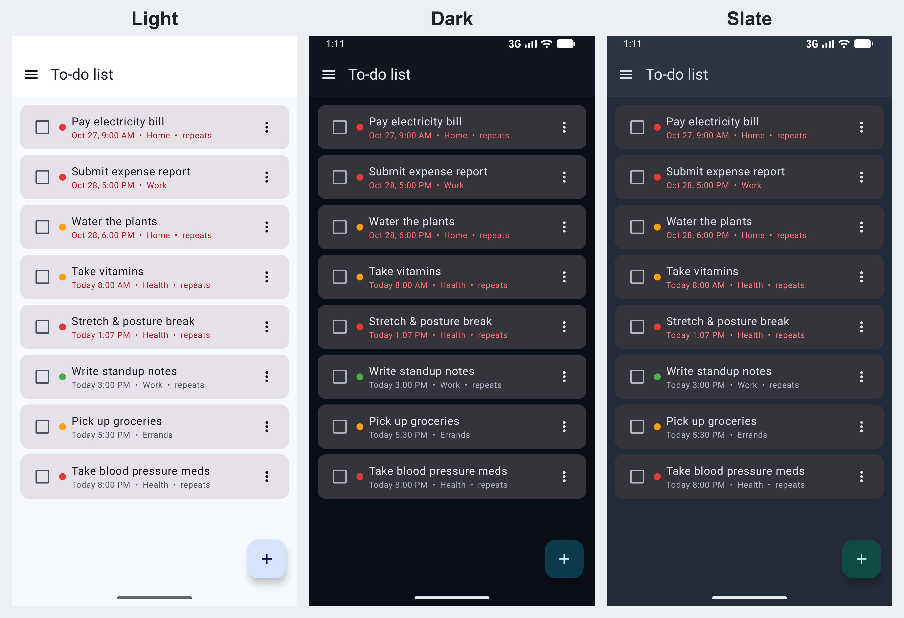
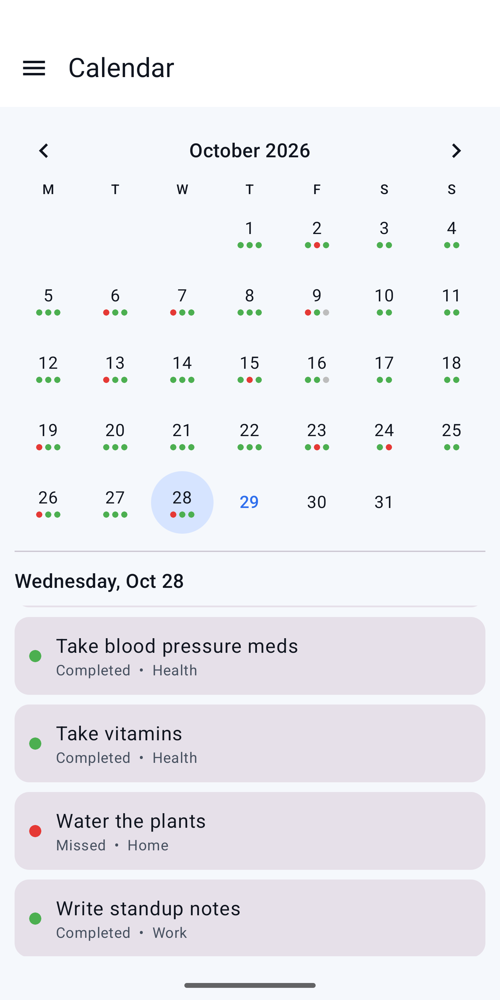

# On Repeat

**Reminders that work the way your tasks do.** On Repeat is an Android task and reminder app built around flexibility: exactly when, how often, and how persistently you get reminded, set per task.

[**Get it on Google Play**](PLAY_STORE_LINK) · [Privacy Policy](PRIVACY_POLICY_LINK)

> The source code for On Repeat is kept in a private repository. This repo is a showcase of what the app does and how it's built.

<table>
  <tr>
    <td></td>
    <td></td>
    <td></td>
  </tr>
  <tr>
    <td></td>
    <td></td>
    <td></td>
  </tr>
  <tr>
    <td></td>
    <td></td>
    <td></td>
  </tr>
</table>

## Why On Repeat

Most to-do apps give you one alert per task, a handful of repeat options, and a snooze button that forgets how many times you've pressed it. On Repeat treats reminders as the main feature.

## Features

### Reminders
- **Multiple independent reminders per task**, with no cap. Set each as an offset ("1 day before," "2 hours before," "at due time") or as a fixed time.
- **Configurable snooze.** Choose your default durations, or pick a custom one in the moment.
- **Snooze limits.** After a set number of snoozes, a reminder can stop itself or escalate, so a task can't be snoozed into oblivion.
- **Persistent, escalating reminders** for tasks that can't be missed. They keep re-notifying at a short interval until you dismiss or complete them.
- **Act from the notification.** Complete and Snooze buttons are on the notification itself.
- **Quiet hours** silence non-urgent reminders during a window you set, with an override for high-priority and escalating ones.
- **Per-priority notification channels**, so sound and vibration can be tuned for each priority level in Android's settings.

### Recurrence
- Daily, weekly, monthly, and yearly patterns, plus custom intervals (every N days, weeks, or months).
- Specific weekdays (Mon/Wed/Fri) and "Nth weekday of the month" patterns, like the 2nd Tuesday.
- Optionally skip weekends.
- End never, after N occurrences, or on a specific date.
- **Fixed or floating scheduling, per task.** Fixed always counts from the original schedule. Floating counts from when you actually completed the task, so finishing something a week late doesn't make it come due a week early next time.

### Daily digest
- Four windows (Morning, Noon, Evening, Night), each of which can be switched on or off and retimed.
- Any task can join one or more windows, in addition to or instead of its own reminders.
- One grouped notification per window lists everything still open.
- **"Dismiss for today" is not "Complete."** Dismissing clears a task from the rest of today's digests without changing its completion status or recurrence schedule.

### Tasks and history
- Title, description, due date and time, priority, category, and completion state.
- A **Someday list** for tasks without a date, so nothing needs a fake due date.
- Custom categories with their own colors. Filter by category and priority.
- **Every occurrence is logged**, not just a task's current state. A calendar view shows what was due on any day and how it resolved, and each task has a streak-style history of completed, missed, snoozed, and pending days. You can correct a day that was logged wrong.

### Reliability and privacy
- Reminders are built to survive reboots and Android's battery-saving restrictions.
- **Fully local.** No account, no login, and no cloud sync. Everything stays on your device.
- Export and import your data as a single file to move to a new device.
- Three themes: Light, Dark, and Slate, chosen independent of the system setting.

## Pricing

On Repeat is free, with no ads and no subscription. A one-time **Pro** unlock adds unlimited categories and all four digest windows with custom times. The reminder engine, including every recurrence type, is never gated.

## Tech stack

| Area | Technology |
|---|---|
| Platform | Android 8.0+ |
| Language and UI | TODO |
| Persistence | TODO |
| Scheduling and notifications | TODO |
| Billing | Google Play Billing |

## Design notes

- **Fixed vs. floating recurrence.** "Next due date = original schedule" is right for a rent payment, but wrong for "water the plants every 7 days." Offering both per task avoids forcing one model on every use case. Floating applies to simple interval recurrence, where "completed date + interval" has one clear meaning.
- **Snooze needs a memory.** Tracking how many times a reminder has been snoozed makes limits and escalation possible. Without that state, snooze is just a way to ignore a task indefinitely.
- **Completing, dismissing, and snoozing are separate actions.** Each does something different to the task and its schedule, and each is an explicit button, so a stray tap doesn't complete anything.
- **Occurrences are records, not just state.** Logging each occurrence is what makes the streak calendar and day-by-day history possible, and what lets you fix a mistake after the fact.
- **Free core, paid extras.** The feature people choose this app for is free. The Pro prompt appears only when a limit actually blocks an action.
- **Reliable alarms.** TODO: one or two sentences on how scheduling survives reboots and battery optimization.

## Contact

Questions or feedback? Reach me through [zstehura.com](https://zstehura.com) or [@Zstehura](https://github.com/Zstehura) on GitHub.
